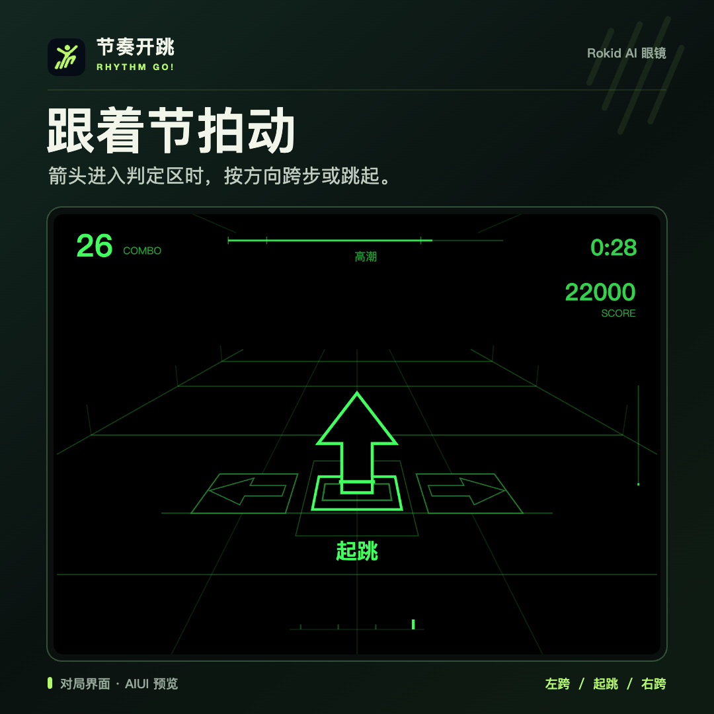
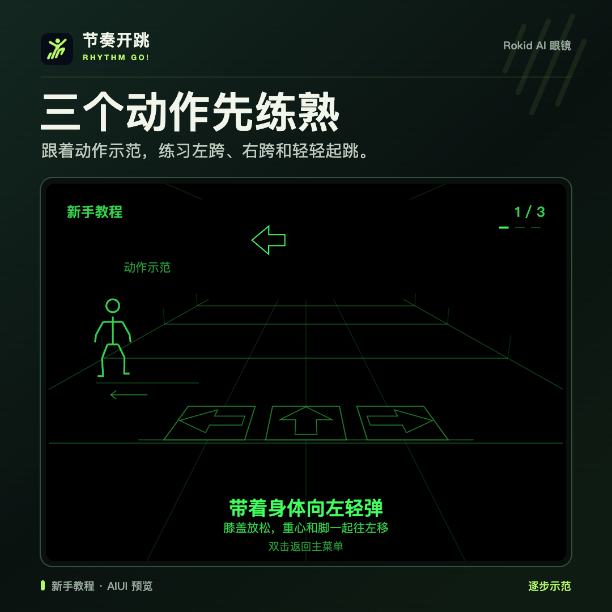
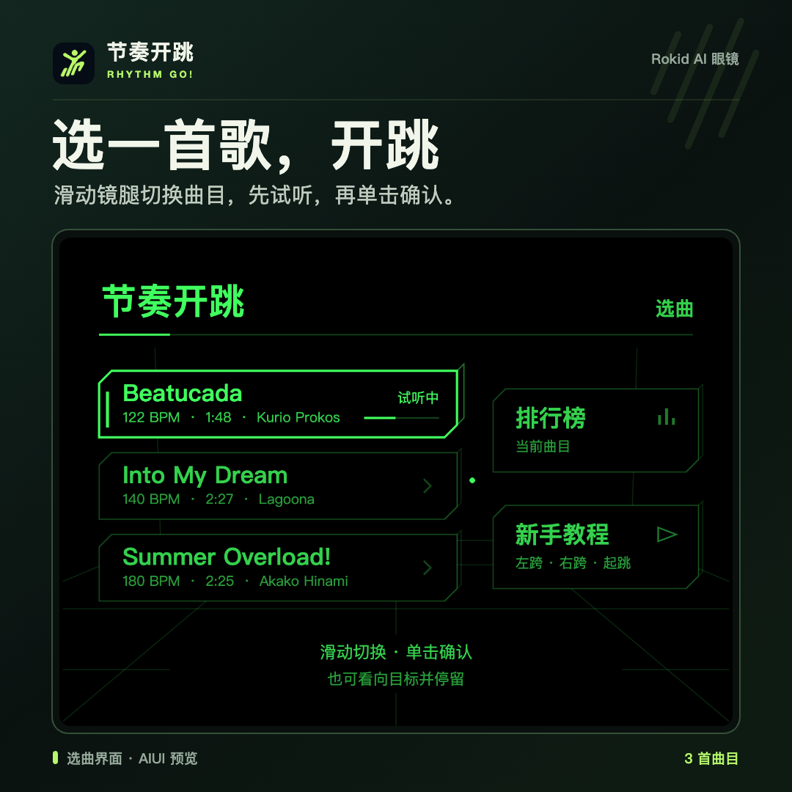

# 节奏开跳（Rhythm Go!）

面向 Rokid AI 智能眼镜的 AIUI 全身体感节奏游戏示例。玩家跟随空间箭头和音乐完成左跨、右跨与原地起跳，眼镜 IMU 驱动动作判定，画面、声音、分数和共享排行榜提供持续反馈。



## 这个示例包含什么

- **AIUI / Ink 全屏应用**：选曲、教程、姿态校准、对局、暂停、结算与排行榜。
- **IMU 动作链路**：加速度、陀螺仪和绝对姿态；站立基准、重力坐标换算、侧移估计、头动补偿与失重检测。
- **统一空间绘制**：同一台透视相机投影舞台、贴地靶位、来袭箭头和判定反馈。
- **灵珠共享排行榜**：通过 `api.agent.invokeAgentApi` 调用工作流，按曲目与谱面版本分榜，本地成绩优先保存。
- **可复现测试**：Node 游戏逻辑/页面/渲染/传感器测试，以及 Python + SQLite 排行榜契约测试。
- **授权曲库**：三首 OutFox Serenity 正式曲目与谱面，附完整来源、许可和修改说明。

> 这是一个真实项目的公开快照，不是精准肢体追踪方案。头部单点 IMU 只能保守推断动作类别；真机佩戴差异、功耗和识别效果仍需独立验证。

## 快速开始

要求：Node.js 22+、Python 3；预览和打包需要 Rokid AIUI 开发环境。

```bash
npm ci
npm run check
npm run test:all
npm run pack
```

- AIUI 导入根目录：`src/`
- 本地包输出：`output/rhythm-jump.aix`
- Studio 预览：`npm run preview`
- 应用发布：在 AIUI Studio 中由开发者手动完成

## 配置自己的排行榜（不会把 ID 提交进仓库）

公开版本默认 `agentId` 为空，排行榜保持离线，本地试玩和成绩保存不受影响。要接入自己的共享榜单：

```bash
# 1. 从示例生成本地配置（只运行一次，不会覆盖已有文件）
npm run config:init

# 2. 编辑 src/lib/service-config.local.js，填入你自己的灵珠 Bot ID
```

- 示例文件：[config/service-config.example.js](config/service-config.example.js)
- 本地文件：`src/lib/service-config.local.js`，已被 `.gitignore` 忽略，**不会进入公开仓库**
- 所有 `npm` 脚本都会先自动执行 `config:init`，新克隆的仓库无需手动准备也能直接检查、测试和打包

后端搭建步骤见 [灵珠排行榜示例](backend/v1/README.md)。请使用自己环境的 Bot ID 与数据表，不要复用他人的 ID。

## 操作

- 镜腿滑动：切换选曲、排行榜或结算焦点。
- 单击：确认、开始、暂停/继续。
- 转头瞄准：停留 3 秒确认，也可单击确认。
- 教程双击：返回选曲。
- 动作：左跨、右跨、原地起跳；控制按键本身不计作运动得分。

首次进入教程或正式曲目前需要站稳平视完成校准。请选择空旷、防滑的位置，并确保眼镜佩戴稳定。

## 界面预览

| 新手教程 | 选曲 |
| --- | --- |
|  |  |

## 目录

```text
src/                  AIUI 唯一导入根
  pages/index/        主页面与交互状态
  pages/research/     默认关闭的研究日志导出页
  lib/body-state.js   姿态、侧移和动作判定
  lib/game.js         时间窗、计分和连击
  lib/spatial-render.js 空间舞台与 HUD
  lib/leaderboard-client.js 灵珠流式协议客户端
  assets/audio/       授权音乐与署名
backend/v1/           灵珠工作流代码节点、协议和 SQLite 契约测试
tests/                Node 自动化测试
tools/                结构检查和研究工具
docs/                 征文、排行榜经验与界面材料
```

## 验证边界

`npm test` 覆盖游戏逻辑、教程、姿态判定、暂停恢复、静止负样本、传感器断流、排行榜客户端和原生绘制；`npm run test:backend` 覆盖协议校验、分数边界、榜单去重与 SQLite 查询。自动化通过不等于完成真机动作识别验收。

研究诊断默认关闭。开启后原始 IMU 只用于本地研究，不随成绩上传；游戏节拍准确率不能冒充真实动作识别准确率。排行榜成绩为客户端上报，不用于发奖或防作弊场景。

## 文档

- [AIUI 征文：用灵珠工作流做 AIUI 后端（跨账号共享排行榜）](docs/aiui-contest-lingzhu-leaderboard.md)（[网页版](docs/aiui-contest-lingzhu-leaderboard.html)，`npm run docs:html` 重新生成）
- [公开快照验证记录](docs/validation.md)
- [灵珠排行榜接入](backend/v1/README.md)
- 配套技能：[rokid-lingzhu-backend](https://github.com/sengmitnick/rokid-lingzhu-backend) —— 把灵珠后端接线、流式回包排障和跨账号共享榜单整理成了可直接调用的 Codex skill
- [共享排行榜 rw_mode 设置与跨账号验收](docs/lingzhu-leaderboard-rw-mode.md)
- [第三方素材与许可](THIRD_PARTY_NOTICES.md)

## 开源许可

原创代码采用 [MIT License](LICENSE)。第三方录音与谱面保留各自的 CC0、CC BY 4.0 或 CC BY-SA 4.0 许可，详见 [THIRD_PARTY_NOTICES.md](THIRD_PARTY_NOTICES.md) 和 [Serenity CREDITS](src/assets/audio/serenity/CREDITS.txt)。
