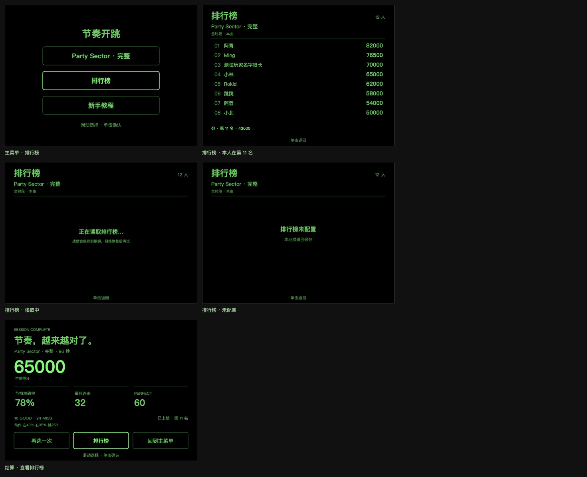

# 用灵珠工作流当 AIUI 应用的后端：跨账号共享排行榜实战

> 征文活动：[AIUI 十二月征文计划](https://forum.rokid.com/post/detail/3911)
> 开源仓库：[https://github.com/sengmitnick/rhythm-jump](https://github.com/sengmitnick/rhythm-jump)
> 配套技能：[rokid-lingzhu-backend](https://github.com/sengmitnick/rokid-lingzhu-backend)
> 智能体名称：节奏开跳　｜　AIUI ID：【真实 AIUI ID】　｜　上架状态：【未提交 / 审核中 / 已上架，附真实链接】

AIUI 应用没有自带服务器。一旦需求从「本机跑起来」变成「把成绩存到云上、按账号排名、换个人登录还能看到别人的分」，就必须有后端。

这篇文章只讲一件事：**怎么用灵珠（数据表 + 工作流 + API 智能体）把一个跨账号共享排行榜做完，并且踩过的坑都写清楚。**

示例项目是体感节奏游戏「节奏开跳」——但游戏本身怎么判定动作不在本文范围，这里只把它当成一个「每局结束时产出一条成绩」的客户端。换个应用，只要你的服务端契约同样是「提交一条成绩 / 读一个榜」，这套做法可以直接搬走。



---

## 一、先把需求翻译成后端契约

排行榜看起来简单，实际要回答五个问题：

| 问题 | 本项目的答案 |
| --- | --- |
| 一条成绩包含什么？ | 谁、哪首歌、哪个谱面版本、多少分、什么时候打的 |
| 榜怎么切？ | 每个 `song_id + chart_version` 一个榜 |
| 重复提交怎么办？ | 每人只取最高分；同分按最早达成 |
| 没登录 / 没网怎么办？ | 本地先存，云端失败只做提示，不阻塞结算 |
| 分数可信吗？ | 客户端上报，服务端只做结构校验；不用于发奖 |

翻译成接口就两个操作：

```text
score.submit      提交一局成绩，返回本人名次
leaderboard.list  读某一首歌某个谱面版本的全时段榜
```

注意这里没有「注册用户」这个操作：AIUI 宿主已经能给出账号，后端不该再让用户填一遍昵称。

## 二、为什么用灵珠，而不是自建服务

自建 Node + PostgreSQL 当然可行（这个项目早期就有一版），但对个人开发者有三个现实问题：要买服务器、要配域名证书、要自己处理账号体系和合规。

灵珠给的是现成三件套：

| 能力 | 在本项目里的角色 |
| --- | --- |
| 数据表 | 存用户快照和成绩流水 |
| 工作流 | 校验、去重、排序、算名次；用代码节点写业务逻辑 |
| API 智能体 | 给 AIX 一个可调用的入口，`api.agent.invokeAgentApi` 直连 |

代价也要说清楚：

- 它不是通用 REST 后端，请求要套进「智能体对话」的形式；
- 回包是**流式文本**，不是标准 JSON Body，解析要按真实时序写；
- 数据表有平台级权限模型（后面 `rw_mode` 那一节就是这个坑）；
- 查询能力有限，本项目只能「取最近 100 行再在代码里排序」。

**结论：适合中小规模排行榜、原型验证和教学示例；不适合高并发、强一致、需要防作弊的正式赛事。**

## 三、数据建模

两张表，职责分开：

| 表 | 作用 | 关键字段 |
| --- | --- | --- |
| `rhythm_user` | 用户快照 | `user_id`、`display_name`、`created_at`、`updated_at` |
| `rhythm_score` | 成绩流水，一次结算一行 | `run_id`、`user_id`、`display_name`、`song_id`、`song_title`、`chart_version`、`score`、`accuracy`、`max_combo`、`perfect`、`good`、`miss`、`played_at`、`score_basis` |

完整字段（含平台系统字段）见 [backend/v1/tables.csv](backend/v1/tables.csv)，可直接照着重建。

四个建模决定，事后看都是必要的：

**1. 分榜键带上谱面版本。** 谱面改了判定标准就变了，用 `chart_version` 把旧分留在旧榜里，避免「改谱之后历史成绩突然全部作废」这种最伤玩家的事。

**2. 显示名存快照。** `rhythm_score.display_name` 是提交当时的昵称，用户后来改名不会改历史榜。代价是同一人不同名，但比「榜单里名字突然全变」可接受。

**3. 时间用服务端时间。** `played_at` 由代码节点 `time.time()` 写入，不信任客户端时钟；同分排名要依赖它，必须可信。

**4. 把信任级别写进字段。** `score_basis` 固定为 `client_reported`。这不是装饰，是让后来接手的人一眼看到「这个分数是客户端说的」。

## 四、工作流：校验在前，查询在后，包装统一

```text
开始(USER_INPUT)
 └→ 代码 A：解析 / 校验（node_dispatch.py）
     └→ 选择器
         ├ score.submit      → 新增用户 → 新增成绩 → 查询本曲前 100 行 → 包装成绩
         ├ leaderboard.list  → 查询本曲前 100 行 → 包装榜单
         └ 否则              → 包装错误
                                  └→ 汇总（node_merge.py）→ 结束(output)
```

三个代码节点各管一件事，边界清晰：

- **代码 A**：把「用户输入的那段 JSON」变成「可信的、字段已校验的 payload」。所有拒绝都发生在这里。
- **数据节点**：只做两件事——按字段值写入、按 `song_id + chart_version` 查询最近 100 行。不在节点里做业务判断。
- **代码 B**：把查询结果变成榜单——按用户去重取最高分、排序、分页、算本人名次。
- **汇总**：三个分支只有一条会产出，取第一个非空的 `response_json`。

这样分工的好处很实际：加一首歌只需要改代码 A 的曲目表；改排序规则只需要改代码 B；数据节点几乎不用动。

### 4.1 代码 A 到底校验什么

这是全篇最值得抄的一段，规则不多但每条都对应一种真实故障：

| 校验 | 挡住的问题 |
| --- | --- |
| 顶层键必须**恰好**是 `v / request_id / actor / op / data` | 客户端多塞字段、按旧版本发请求 |
| JSON 重复键直接报错 | `{"score":1,"score":99999}` 这类解析歧义 |
| 请求体 ≤ 24 KB | 恶意大包拖垮节点 |
| `op` 必须在白名单内 | 未定义操作被当成默认分支执行 |
| `song_id + chart_version` 在曲目表内 | 伪造曲目、旧谱面混进新榜 |
| `perfect + good + miss == notes` | 统计造假的成绩（拍数按曲目/版本查表） |
| `max_combo <= perfect + good` | 连击大于命中数 |
| `score <= 1000×perfect + 500×good` 且 `0 ≤ score ≤ 1000×notes` | 秒结算、分数超上限 |
| 文本字段 ≤ 24 字、无控制字符、无尖括号 | 昵称注入和排版炸裂 |
| `accuracy` 不由客户端上传 | 准确率一律服务端按 `(perfect + 0.6×good) / notes` 计算 |

曲目表本身也很小，新增歌曲就是加一行：

```python
SONGS = {
  'beatucada': {'title': 'Beatucada', 'duration_ms': 108475,
                'notes_by_version': {1: 32}},
  'into-my-dream': {'title': 'Into My Dream', 'duration_ms': 146571,
                    'notes_by_version': {1: 54}},
  'summer-overload': {'title': 'Summer Overload!', 'duration_ms': 145424,
                      'notes_by_version': {1: 55}},
}
```

**一个容易忽略的点：拍数必须和谱面同源。** 拍数写在代码 A 里、谱面在客户端里，两边只要有一次不同步，所有成绩都会被判「统计不一致」。改谱必须同时发客户端和工作流。

### 4.2 代码 B：榜单是在「窗口内」算的

数据节点返回最近 100 行，代码 B 在这 100 行里：

1. 按 `user_id` 去重，只留最高分；
2. 同分按 `played_at` 升序（早达成者在前），再按 `user_id` 兜底稳定排序；
3. 截断到 `limit`（1–20，默认 8）；
4. 标记 `is_me` 并计算本人名次（本人不在前 `limit` 时单独返回一条）。

这意味着 `total_players` 只是「窗口内的人数」，不是全站人数。用户量真的涨起来，必须换成分页或服务端排序。这个限制写进了文档，而不是假装没有。

## 五、协议：一个小而完整的信封

```json
{
  "v": "rhythm-jump/1",
  "request_id": "req_8f3c...",
  "actor": { "id": "rokid_account_id", "name": "玩家" },
  "op": "leaderboard.list",
  "data": { "song_id": "beatucada", "chart_version": 1, "limit": 8 }
}
```

响应形如 `{"v":"rhythm-jump/1","request_id":"...","ok":true,"data":{...}}`，失败时 `ok:false` 并带 `error.code / error.retryable`。

三个细节：

- `request_id` 是为「串台」准备的。用户快速切歌时，上一首的榜可能后到；客户端只接受与当前请求匹配的回包，否则直接丢弃。
- `actor` 是身份，不是凭据。它来自 `getProfile().accountId`，平台没有为它签名。
- `v` 变动即协议不兼容，宁可报错也不要猜字段。

另外，工作流最终把 JSON 放在 `RHYTHM_RESULT` 前缀之后返回，灵珠部分调试入口还会再包一层 `{"output":"..."}`。客户端必须两种都能吃。

## 六、AIX 客户端：流式回包比文档难伺候

AIX 侧就是一个函数调用，但返回的是流，真实接入时会同时遇到四种形态：

| 形态 | 出现场景 |
| --- | --- |
| 分段 `message.content` | 正常流式输出，正文被切成很多片 |
| 结束事件的 `final_answer` | 有些宿主只在结束时给完整文本 |
| `message.metadata.output` | 工作流输出变量走元数据 |
| 先空 `end`、正文后到 | 真机联调时出现过，最坑的一种 |

[src/lib/leaderboard-client.js](src/lib/leaderboard-client.js) 的处理方式：

```js
stream = api.agent.invokeAgentApi({
  body: {
    conversation_id: this._conversationId,
    agent_id: this.agentId,
    question: JSON.stringify(envelope)
  }
});
```

- 三种文本来源一起收集，任意一种能解析成功就完成；
- 遇到 `end` 时先给 1.5 秒宽限期（`END_REPLY_GRACE_MS`），避免「正文还在路上就判失败」；
- 解析前校验 `v` 与 `request_id`，再判断 `ok`；
- 外层 `{"output":"..."}` 只解一层，解不开就按协议错误报告，不猜；
- 整体 15 秒超时，流错误与解析错误分开归类，界面文案也不同。

这些分支听着琐碎，但每一条都对应一次真实失败。**后端写得再对，客户端把回包读错，用户看到的就是「排行榜没有返回内容」。**

## 七、最疼的坑：`rw_mode`

### 7.1 现象

两个账号都能提交成绩，工作流查询语句里也确实只按 `song_id + chart_version` 过滤，但每个账号登录后**只能看到自己的成绩**。

第一反应是去查 SQL、查排序、查去重代码——全是错的。问题在数据库表的权限模式。

### 7.2 原因

| `rw_mode` | 模式 | 对共享榜的影响 |
| --- | --- | --- |
| `1` | 单用户读写（LimitedReadWrite） | 平台按调用者给记录加范围，谁登录只看自己的 |
| `2` | 用户只读（ReadOnly） | 玩家提交不了成绩 |
| `3` | 多用户读写（UnlimitedReadWrite） | 可跨用户查询，共享榜必须用这个 |

**`rw_mode` 是表级属性，不是工作流属性，也不是 AIX 配置。** 工作流访问表时平台会应用它；查询节点没写 `user_id` 条件，不代表查询已经跨账号。

### 7.3 修改纪律

1. 先**备份完整表配置**（含字段 ID、顺序、类型、必填），不要只记一个模式值；
2. 只改目标表：成绩表 `rhythm_score` 改成 `3`，账号资料表 `rhythm_user` 保持原权限，**不做批量放开**；
3. 更新后**回读**，确认 `id`、表名、字段列表与备份一致（平台更新接口的响应里有些元数据是占位值，不能拿它当最终状态）；
4. **用两个真实账号验收**：A、B 各自完成同一曲目，双方都能在榜里看到彼此的分数，「你」的标记跟随当前登录账号。

第 4 步不能省。单账号试运行、在请求 JSON 里换一个 `actor.id`、本地跑一遍排序测试，都**证明不了**平台的调用者隔离已经解除。

本项目只把 `rhythm_score` 从 `1` 改成 `3`，回读确认 14 个业务字段未变；修复后多个账号的历史成绩在同一榜单中可见，Studio 查榜与眼镜端均确认过。完整操作步骤（含离线生成更新正文的脚本、回读核对、验收清单）整理在 [docs/lingzhu-leaderboard-rw-mode.md](docs/lingzhu-leaderboard-rw-mode.md)，也做成了可调用技能 [rokid-lingzhu-backend](https://github.com/sengmitnick/rokid-lingzhu-backend)。

> 补充一句边界：`rw_mode: 3` 给的是「能跨用户读写」的能力，不等于细粒度权限系统。本项目只开放「新增成绩」和「查询榜单」，没有修改、删除他人成绩的接口。

## 八、信任边界：能排名，不代表分数可信

服务端做了九条校验，能挡住秒结算、统计造假、超上限分数。但它挡不住：

- 修改客户端直接上报一个合法范围内的假分数；
- 重放一段真实成绩；
- 伪造 `actor.id` 冒充别人。

因为 `actor` 只是客户端声明，平台没有设备证明。所以：

- 榜单定位是**展示与自娱**，不能用于发奖；
- 真要办比赛，需要另做服务端验证、请求签名、防重放、可信身份链路；
- 这些限制写进 README 和协议文档，而不是留在开发者脑子里。

把「不可信」标注出来，比写一个看起来很严谨的校验函数更有价值。

## 九、智能体 ID 不进仓库

排行榜要一个 Bot ID。写进源码再开源，等于把自己的线上入口交出去——别人不仅能看，还能往你的表里写数据。

所以仓库用「示例配置 + 本地忽略」：

```text
config/service-config.example.js     ← 入库，agentId 为空
src/lib/service-config.local.js      ← git 忽略，存真实 Bot ID
src/lib/service-config.js            ← 运行时入口，只做再导出
```

```bash
npm run config:init   # 从示例生成本地配置；已存在则不覆盖
```

两个配套设计：

- 所有 npm 脚本（`check` / `test` / `pack` / `preview`）都会先跑 `config:init`，新克隆的仓库开箱即可检查、测试、打包，不会因为缺文件报错；
- 初始化**永不覆盖**已有文件，填好的配置在拉代码、升级后依然保留。

`agentId` 为空时排行榜就是离线态（界面上是「排行榜未配置 · 本地成绩已保存」），本地成绩照常保存，不影响试玩。

## 十、验证：哪些是自动化的，哪些还没做

### 10.1 可重复的部分

2026-11-24，从公开快照干净安装后：

```bash
npm ci --cache .npm-cache
npm run check
npm run test:all
npm run pack
```

| 检查 | 结果 |
| --- | --- |
| 工作流契约测试（Python + 内存 SQLite） | **15 项通过** |
| 排行榜客户端测试（Node） | **11 项通过** |
| 全仓库回归 | **186 项通过，0 失败** |
| AIUI 结构检查 | 通过，本地模块路径全部解析 |
| AIX 打包 | 通过，约 3.50 MB |

契约测试覆盖：协议外壳与多余字段、重复键、曲目与谱面白名单、分数上限、判定数与拍数一致性、每人最高分与同分排序、本人不在前 N 时的名次、错误透传、以及 SQLite 里真实查询与包装逻辑的一致性。

客户端测试覆盖：编码与解析、白名单拒绝、超时、无账号、用户同步失败不影响成绩、空 `end` 后补正文、只有 `final_answer`、只有 `metadata.output`、外层 `{"output":"..."}` 包裹。

### 10.2 还不能声称的

- 没有做压测：100 行窗口在千人量级会失效，这是已知设计上限；
- 没有做安全审计：分数不可信的结论只基于代码阅读，不是渗透测试；
- 真机证据仅限于「共享榜单在眼镜端可见」，不代表任意网络条件下都稳定；
- 本文不给出任何识别类指标——那是游戏侧的事，与后端无关。

完整记录见 [docs/validation.md](docs/validation.md)。

## 十一、想在自己的 AIUI 项目里复用，照着这张清单做

1. 想清楚**榜怎么切**（按关卡？按难度？按赛季？），把它变成表里的一个字段；
2. 建两张表：用户快照 + 成绩流水，成绩表写 `score_basis`；
3. **只改成绩表**的 `rw_mode` 为 `3`，账号表保持私有；改前备份、改后回读；
4. 工作流按「校验 → 分支 → 数据节点 → 包装 → 汇总」搭，校验全部集中在代码 A；
5. 客户端先写本地，再同步云端，云端失败只提示不阻塞；
6. 客户端解析回包时同时兼容 `content` / `final_answer` / `metadata.output` / 空 `end`；
7. 用 `request_id` 丢弃过期回包；
8. **用两个真实账号**验收共享榜单；
9. 在 README 顶部写清「分数是客户端上报，不用于发奖」。

## 十二、复盘

**1. 平台权限模型比查询语句更先决。** 查不到别人的数据，先看表的 `rw_mode`，再看 SQL。

**2. 回包格式要按真实时序写，不要按文档写。** 空 `end` 之后补正文这种事，只有真机会告诉你。

**3. 校验要集中，数据节点要笨。** 节点里做业务判断，改一次需求就要重连一次工作流。

**4. 拍数这类「两边都有的常量」是长期隐患。** 能放服务端就放服务端，放不下就必须在发版清单里绑死。

**5. 信任边界要写进数据模型。** `score_basis` 一个字段，省掉无数次解释。

后续真正该做的：把「取 100 行再排」换成服务端排序分页；给成绩提交加签名与防重放；把用户表改成 `upsert` 而不是每次插快照。

## 十三、开源与素材

```text
backend/v1/  灵珠代码节点、协议、表结构、契约测试（本文主体）
config/      智能体定义、服务配置示例
src/lib/     排行榜客户端与协议解析
docs/        本文、rw_mode 指南、验证记录
```

- 仓库：[https://github.com/sengmitnick/rhythm-jump](https://github.com/sengmitnick/rhythm-jump)
- 网页版（GitHub Pages）：[https://sengmitnick.github.io/rhythm-jump/](https://sengmitnick.github.io/rhythm-jump/)
- 配套技能：[rokid-lingzhu-backend](https://github.com/sengmitnick/rokid-lingzhu-backend)（在 Codex 里用 $rokid-lingzhu-backend 调用）
- 原创代码：[MIT License](LICENSE)　｜　第三方素材：[THIRD_PARTY_NOTICES.md](THIRD_PARTY_NOTICES.md)
- 对应版本：【Tag 或 Commit】

文中排行榜截图使用测试昵称（阿青、Ming、小林等），不含真实玩家数据。示例仓库不包含真实 Bot ID、数据库表 ID、账号信息与线上成绩。

---

## 作者提交前核对项

- [ ] 补充作者昵称、真实 AIUI ID、实际上架状态与可核验链接。
- [ ] 补充最终 Tag / Commit 与跨账号验收截图。
- [ ] 论坛以「普通贴」发布到「征文计划」板块并保持公开可见。
- [ ] CSDN 发布同一篇原创文章，可见范围设为「全部可见」。
- [ ] 如参与多平台奖励，按活动规则补充对应平台链接与截图。
